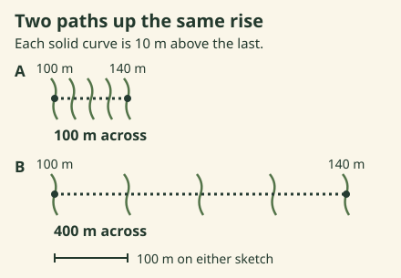

# Learnings via Graphics

A visual newsletter for people meeting a subject for the first time. Make a prediction, open the answer, and follow a short illustrated brief if you want to keep going.

## The Sunday issue · November 15, 2026

### A hill, a heat pump and a book fair

**Both paths reach the same height. Which would you expect to climb more gently?**

Check your map reading

Path B spreads the same 40-metre rise over four times the horizontal distance. Its average grade is 10%. Path A’s is 40%. The drawing tells you the slope, while the footing needs a separate check.

**[Open this issue and try all three puzzles](issues/2026-11-15.md)**

| Pick a story | What you’ll do |
| --- | --- |
| [Everyday life · Read a hill](editions/2026-11-15-reading-contours/brief.md) | Compare two pencil paths on a map. Watch Ordnance Survey trace a real hillside. |
| [Frontier technology · Follow the heat](editions/2026-11-15-heat-pump/brief.md) | Find the missing energy when one unit of electricity delivers three units of heat. |
| [Work & money · Run a book-fair table](editions/2026-11-15-zine-table/brief.md) | Work out which sale covers a table fee and what changes when paper costs more. |

### The library

| Section | Open a visual brief |
| --- | --- |
| [Engineering · The Builder’s Workbench](archive.md#engineering) | [Choose a database index from evidence](editions/2026-11-25-database-index-tradeoff/brief.md) · [Diagnose a suite-only test failure](editions/2026-11-21-test-isolation/brief.md) · [Make one retry create one order](editions/2026-11-17-idempotency-key/brief.md) · [Safe Saves](editions/2026-10-13-safe-saves/brief.md) · [When an AI should say “I don’t know”](editions/2026-10-12-rag-that-can-abstain/brief.md) |
| [Frontier technology · The Horizon](archive.md#frontier-technology) | [Read the grid’s balance signal](editions/2026-11-26-grid-balance/brief.md) · [Why seeing is not yet grasping](editions/2026-11-22-robot-grasp-pipeline/brief.md) · [Why fast charging slows near full](editions/2026-11-19-ev-charge-taper/brief.md) · [Why processors use chiplets](editions/2026-11-15-chiplets/brief.md) · [Where the heat comes from](editions/2026-11-15-heat-pump/brief.md) |
| [Everyday life · Dad’s Field Notes](archive.md#everyday-life) | [Close a communication loop](editions/2026-11-27-check-back/brief.md) · [Choose a winter-surface treatment](editions/2026-11-24-road-salt-timing/brief.md) · [Read window condensation](editions/2026-11-20-window-condensation/brief.md) · [Respond to a smoke-alarm chirp](editions/2026-11-16-smoke-alarm-chirp/brief.md) · [Reading contour lines](editions/2026-11-15-reading-contours/brief.md) |
| [Work & money · Career & Independence](archive.md#work-and-money) | [Map a job posting to evidence](editions/2026-11-28-job-evidence-map/brief.md) · [Read a pay stub](editions/2026-11-23-read-a-pay-stub/brief.md) · [Make a portfolio claim inspectable](editions/2026-11-18-portfolio-evidence-chain/brief.md) · [Interest on interest](editions/2026-11-15-compound-interest/brief.md) · [The first sale that covers costs](editions/2026-11-15-zine-table/brief.md) |

Briefs, diagrams and answer reveals open on GitHub. Each brief takes about 3–5 minutes. To move the controls in a full guide, download the source ZIP, extract it and open its `index.html` in your browser. [Reading and lab instructions](docs/reading-guide.md) · [Browse the archive and back issues](archive.md) · [Contribute a story](CONTRIBUTING.md)
