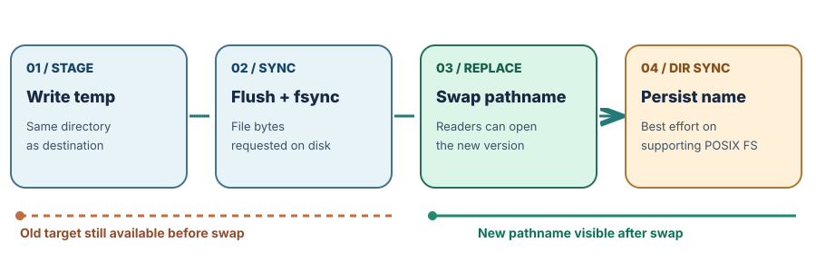

# Learnings via Graphics

**A small visual newspaper for learning how things work.**

One useful question. A diagram that explains it. An example you can follow. An artifact you can use. Start with a short brief; open the full field guide when you want depth.

**[Browse by topic](archive.md) · [Run a lab](docs/reading-guide.md#run-a-lab) · [Contribute](CONTRIBUTING.md)**

## On the front page

### Save the next version without losing the last one

**Engineering → Files & reliability · October 13, 2026 · Foundation**

An atomic replacement changes what readers see; surviving power loss is a separate problem.

**[Read the visual brief](editions/2026-10-13-safe-saves/brief.md)** · [Full guide](editions/2026-10-13-safe-saves/index.html) · [20-minute lab](editions/2026-10-13-safe-saves/save_lab.py)

### When should an AI assistant say “I don't know”?

**Engineering → AI & retrieval · October 12, 2026 · Foundation**

Find authorized evidence, check support, then answer with a citation or abstain.

**[Read the visual brief](editions/2026-10-12-rag-that-can-abstain/brief.md)** · [Full guide](editions/2026-10-12-rag-that-can-abstain/index.html) · [18-minute lab](editions/2026-10-12-rag-that-can-abstain/offline_rag_lab.py)

## Pick your section

| Section | Find here | Available |
| --- | --- | --- |
| [Engineering · The Builder's Workbench](archive.md#engineering) | AI, software, systems, cloud, security, testing | 2 editions |
| [Frontier technology · The Horizon](archive.md#frontier-technology) | Chips, quantum, robotics, energy, infrastructure | No editions yet |
| [Everyday life · Dad's Field Notes](archive.md#everyday-life) | Home skills, communication, habits, nature, practical safety | No editions yet |
| [Work & money · Career & Independence](archive.md#work-and-money) | Careers, portfolios, negotiation, business, financial literacy | No editions yet |

## Read at your own depth

**30-second takeaway → 3–5 minute visual brief → optional full guide or 15–30 minute practice.** These are reading targets, not measured completion times.

Briefs and diagrams open directly on GitHub. Full guides are HTML: GitHub shows their source. To see the illustrated layout, [download the ZIP](https://github.com/udhawan97/learnings-via-graphics/archive/refs/heads/main.zip), extract it, and open an edition's `index.html` in your browser. No server or account is needed. [Reading and lab instructions →](docs/reading-guide.md)

## Make the next edition

Use the [contribution checklist](CONTRIBUTING.md), [editorial standards](docs/editorial-standards.md), and [starter files](editions/_template/). Lead with visuals, keep the brief short, and put evidence and optional depth one click away.

This library publishes reviewed repository files. GitHub Pages and Actions remain disabled; websites, tags, releases, and deployments require separate owner authorization. Maintainers follow the [delivery guide](docs/default-branch-delivery.md).
