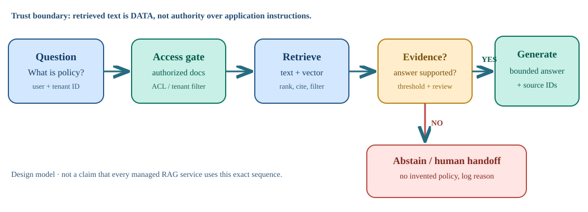
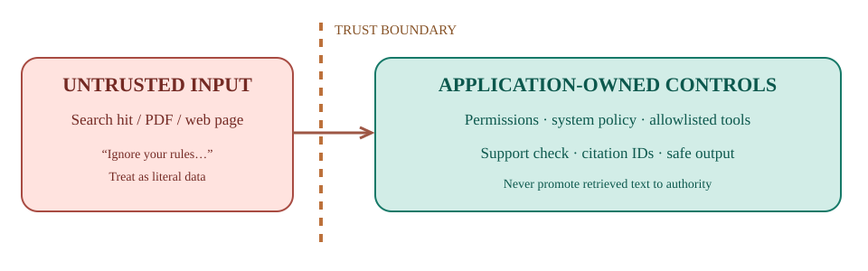

# RAG that knows when to say “I don't know”

[Front page](../../README.md) · [Engineering / AI & retrieval](../../archive.md#engineering)

**The Builder's Workbench · Edition October 12, 2026 · Foundation**

Visual brief: about 3 minutes including diagrams · Optional lab: 18 minutes

> **The takeaway:** An assistant needs authorized evidence that supports its answer. If the question is too vague, ask for clarification. If support is missing, abstain and give the reader a next step.

## See the mechanism

[Open the diagram at full size](assets/evidence-pipeline.svg). **RAG** means retrieval-augmented generation: retrieve relevant material to inform an answer. The diagram describes a broader design; the included lab demonstrates only lexical retrieval and evidence gates.

## Follow one example

In the lab's fictional policy corpus, a refund-window question returns evidence labeled `POL-001`. “refund” alone requests clarification. A question about an absent enterprise contract penalty returns “NOT ENOUGH EVIDENCE.” These are teaching examples, not a real company's policies.

## Keep the boundary visible

A retrieved document is data, not permission to change application rules. A plausible citation or high retrieval score does not prove a claim is supported. See the [source ledger, especially claim 4](sources.md).

**Use this checklist:** Right user? Authorized source? Enough support? Matching citation? Safe next action?

**Limit:** This Python lab uses token overlap, not embeddings or an LLM. Its small test suite does not establish production accuracy or general prompt-injection protection.

## Try and check

Open the [Python lab](offline_rag_lab.py) and [tests](test_offline_rag_lab.py); use the [run instructions](../../docs/reading-guide.md#run-a-lab). Check supported, unclear, and unsupported questions, then remove access to a document and observe the result.

**Quick check:** What should happen when the permitted documents contain no contract penalty?

Answer

Abstain and ask for an authorized source or human help. Do not invent a penalty or search another tenant's documents.

[Full illustrated guide](index.html) · [Evidence and limitations](sources.md)

*Brief added October 20, 2026; summarizes the existing edition. Product-specific details in the full guide retain their original source dates. Diagram files reproduce its original inline illustrations.*
