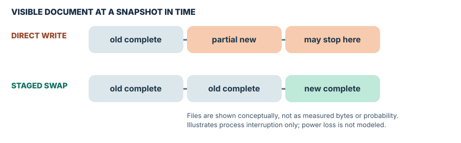

# Safe Saves: atomic replacement vs durability

[Front page](../../README.md) · [Engineering / Files & reliability](../../archive.md#engineering)

**The Builder's Workbench · Edition October 13, 2026 · Foundation**

Visual brief: about 3 minutes including diagrams · Optional lab: 20 minutes

> **The takeaway:** Prepare the complete next version before replacing the old pathname. Atomic visibility means readers see an old or new target; it does not, by itself, prove the new data survives power loss.

## See the mechanism

[Open the diagram at full size](assets/save-flow.svg). For one writer in a trusted local directory: **stage → sync file → replace → sync directory where supported**. A successful POSIX replacement changes the pathname atomically; syncing addresses a separate persistence concern. See [sources P1, P2, and L1](sources.md).

## Follow one example

A note contains “Version A.” Writing “Version B” directly over it can leave partial bytes if interrupted. Staging B in a sibling temporary file keeps A at the destination until replacement succeeds.

These are conceptual process states, not measured crash probabilities. Existing open file handles may still refer to the old file.

## Keep this checklist

- Prepare the whole replacement in the destination directory.
- Flush buffered writes and request file sync before replacement.
- Attempt parent-directory sync where supported; surface failures honestly.
- Handle backups and competing writers separately.

**Limit:** The lab tests ordinary injected exceptions. It does not test hardware power loss, hostile directories, network storage, or concurrent writers.

## Try and check

Open the [Python lab](save_lab.py) and [tests](test_save_lab.py); use the [run instructions](../../docs/reading-guide.md#run-a-lab). Success means the injected pre-replacement failure preserves A, and the subsequent successful replacement writes B.

**Quick check:** Can two writers each save a complete file and still lose an edit?

Answer

Yes. Atomic replacement alone does not coordinate writers; a later replacement can overwrite the earlier edit.

[Full illustrated guide](index.html) · [Evidence and limitations](sources.md)

*Brief added October 20, 2026; summarizes the existing edition. Diagram files reproduce its original inline illustrations.*
