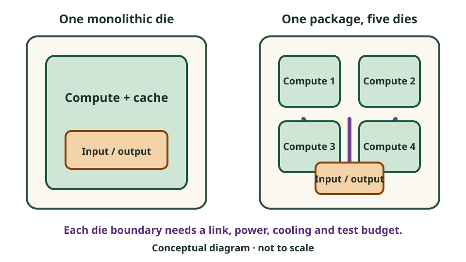

# Why split a processor into chiplets?

**Frontier technology · The Horizon · 3–5 minutes**

Compare two 16-core designs. One places cores, cache and input/output on one large die; the other places four reusable compute dies beside an input/output die in one package.

Predict: **which design makes an eight-core sibling easier to create without redesigning every block?**

## Takeaway

A chiplet is a small silicon die designed to work beside other dies in one package. Splitting a processor can reuse proven blocks, mix manufacturing processes and scale beyond one large die. The boundary matters: every split adds links, packaging, power, latency and test work, so modular does not automatically mean faster or cheaper.

## Follow the boundary

A **monolithic** processor keeps major functions on one die. A chiplet design partitions them across dies connected inside the package. UCIe is one package-level die-to-die standard.

The split can help in three ways:

1. A product family can reuse a compute tile in different quantities.
2. Each function can use a suitable manufacturing process.
3. Several dies can exceed one reticle-limited die’s area.

An on-die wire and a die-to-die link are not equivalent. A boundary can cost latency, bandwidth, power and packaging effort while expanding test and integration work.

## Worked example

The invented “Nova” processor uses four identical four-core compute chiplets plus one input/output chiplet. An eight-core sibling could reuse two compute chiplets and the input/output design. That demonstrates **reuse and configuration flexibility**, not lower cost or higher speed. Engineers still need measurements.

## Try: budget one boundary

For one proposed split, record:

- **Reason:** Does the block repeat, scale independently or suit another process?
- **Traffic:** What crosses the boundary, at what bandwidth and latency?
- **Integration:** How will the package handle power, heat and test?

**Quick check:** Does a standard die-to-die link make any two chiplets automatically work together?

Answer

No. A standard can define parts of the electrical and protocol connection, but a working product still needs compatible functions, packaging, power, thermal design, firmware, security and compliance testing.

## Visible limit

The diagram and Nova example are conceptual, not a floorplan, cost model or performance benchmark. Real partition choices depend on workload, manufacturing, packaging and product goals. [Read the source ledger and claim boundaries](sources.md), or continue with the [full offline guide](index.html).
