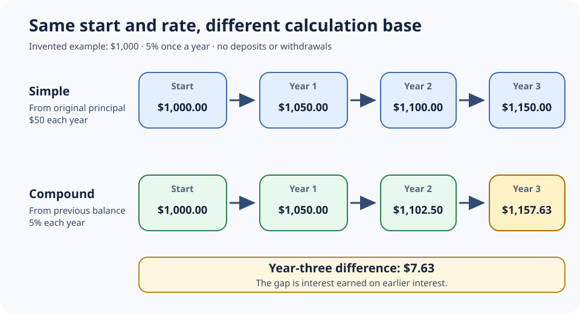

# Where does interest on interest come from?

[Front page](../../README.md) · [Resource index](../../archive.md)

**Work & money / Career & Independence · Financial literacy · Edition 2026-11-15 · Foundation with dated consumer guidance**

Visual brief: 4 minutes · Optional practice: 20 minutes

> **The takeaway:** Compound interest adds each period’s interest to the balance used for the next calculation. Simple interest keeps calculating from the starting principal. The gap begins small and grows with time, but a rate alone does not include every fee, tax, inflation effect, withdrawal, or future rate change.

## Predict the third year

Imagine $1,000 earning 5% once a year, with no deposits or withdrawals. After year one, both methods show $1,050. **Which balance will be higher after year three: simple or compound interest?**

[Open the full-size comparison](assets/growth-paths.svg). This is an invented arithmetic example, not a quoted account offer or forecast.

## Follow the calculation

**Simple interest** uses the original $1,000 each year: 5% is $50, so three years add $150.

**Compound interest** updates the base:

1. Year 1: $1,000 × 1.05 = $1,050
2. Year 2: $1,050 × 1.05 = $1,102.50
3. Year 3: $1,102.50 × 1.05 = $1,157.63 after rounding

The extra $7.63 came from earning interest on earlier interest. CFPB calls the starting amount the **principal**.

## Keep this rate card

For each example, record:

- starting principal;
- stated rate and whether it is fixed or variable;
- compounding frequency;
- time;
- deposits and withdrawals;
- fees, taxes and inflation left outside the calculation.

Success means another person can reproduce your balance from the same inputs.

**Limit:** This worksheet explains arithmetic. It does not predict returns or determine whether an account or investment is suitable. For deposit accounts, APY is designed to reflect the relationship between principal and interest over a year; read the institution’s disclosures too.

## Try and check

**Quick check:** At the end of year two, how much larger is the compound balance than the simple-interest balance?

Reveal the answer

Simple interest gives $1,100. Compound interest gives $1,102.50. The difference is **$2.50**—interest earned during year two on the $50 added after year one.

## Keep exploring

Use [Investor.gov’s compound interest calculator](https://www.investor.gov/financial-tools-calculators/calculators/compound-interest-calculator) to change one input at a time. [CFPB explains the first two years of the same $1,000-at-5% example](https://www.consumerfinance.gov/ask-cfpb/how-does-compound-interest-work-en-1683/).

[Full illustrated guide and worksheet](index.html) · [Evidence and limitations](sources.md)
