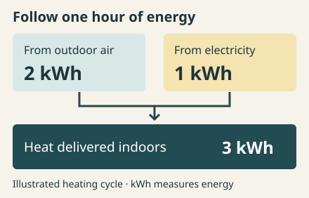

# Where do the other two units of heat come from?

[Front page](../../README.md) · [Frontier technology / Heating and energy](../../archive.md#frontier-technology)

**The Horizon · November 15, 2026 · Deployed technology**

Visual brief about 3 minutes · Optional paper practice about 15 minutes

> A heat pump uses electricity to carry heat indoors. That gives the room two sources of energy to count. In our example, one unit of electricity and two units drawn from outdoor air deliver three units of heat. A real machine’s performance changes with conditions, so this one example cannot predict a winter bill.

Picture a refrigerator. Its inside cools while the coils on the back give heat to the room. A heat pump heating a home can take heat from outdoor air and release it indoors. Electricity runs a compressor that raises the pressure and temperature of the circulating fluid. That warmed fluid can then release heat to the room. Air-source heat pumps already do this in homes. [Open the energy diagram](assets/heat-balance.svg)

### Account for an hour

Imagine a meter recorded **1 kilowatt-hour** of electricity and the room received **3 kilowatt-hours** of heat during the same hour. A kilowatt-hour, abbreviated kWh, is an amount of energy. Cover the line labelled “outdoor air” in the drawing. What amount belongs there?

Reveal the missing energy

The missing 2 kWh came from outdoor air. For this simplified heating cycle, 2 kWh collected outside plus 1 kWh of electricity equals 3 kWh delivered inside. Heating performance for that hour is 3 divided by 1, or 3.

Draw two boxes on a scrap of paper, one for each input. Keep electricity at 1 kWh but put only 1 kWh in the outdoor box. The indoor total is now 2 kWh. That little sketch lets you check any similar claim once the time interval and the measurement boundary match.

These invented hours leave out losses outside the room boundary and backup heating. To compare actual equipment, look for the outdoor temperature and the conditions attached to a rating.

For a first look, follow the refrigerator example in “How They Work.” For a closer look, find “Coefficient of Performance” in the Canadian guide. [U.S. Department of Energy explainer](https://www.energy.gov/articles/pump-your-savings-heat-pumps) · [Natural Resources Canada guide](https://natural-resources.canada.ca/energy-efficiency/energy-star/heating-cooling-heat-pump)

[Change the outdoor heat input offline](index.html#try) · [Full guide](index.html) · [Sources and assumptions](sources.md)
