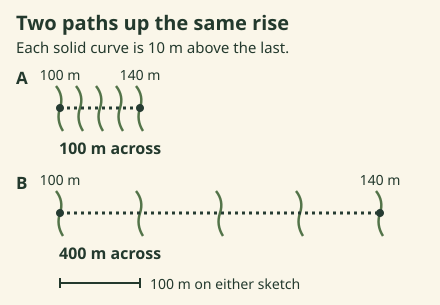

# Which path climbs more steeply?

[Front page](../../README.md) · [Everyday life / Map reading](../../archive.md#everyday-life)

**Dad’s Field Notes · November 15, 2026 · Foundation**

Visual brief about 3 minutes · Optional paper practice about 15 minutes

> A contour joins places at the same height. Two paths can climb the same forty metres and feel very different underfoot. Compare how much horizontal distance each path uses to gain that height. Read the scale and the contour interval first. The map can show steepness even when it tells you little about the footing.

**Which line of dots would you pick for the gentler climb?** Trace each from left to right. The dotted lines mark imaginary paths. Each solid curve joins points of equal height. On both sketches the contour interval, the height difference from one curve to the next, is ten metres. [Open the original drawing](assets/contours.svg)

Check your prediction

Path B. From 100 to 140 metres there are five curves, including the two labelled ends, but only four gaps. Both paths gain 40 metres. Path A gains that height in 100 horizontal metres. Path B has four times as much horizontal distance for the same climb.

### Take this to another map

Find the contour interval in the map key. Put a fingertip on each end of one uphill stretch and subtract the two height labels. Measure the distance along that path on the map and convert it with the scale. Divide the rise by that horizontal distance. For A, 40 divided by 100 is 0.4, or a 40% average grade. It means forty metres of climb per hundred metres across. For B the same calculation gives 10%.

Try changing just the distance to 200 metres on paper. A 40-metre rise now gives a 20% average grade. A stretch of steps could still be much steeper than that average. Footing, access and weather are separate questions a contour sketch cannot settle.

Watch Steve Backshall trace a hill, or follow the illustrated version at your own pace. [Ordnance Survey video on YouTube](https://www.youtube.com/watch?v=4i_6eToM3X8) · [Illustrated map-reading guide](https://osmaps.com/discover/guides/understanding-map-contour-lines-for-beginners/)

[Explore the three distances offline](index.html#try) · [Full guide](index.html) · [Sources and assumptions](sources.md)
