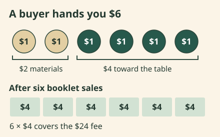

# Which booklet pays for the table?

[Front page](../../README.md) · [Work & money / Small business costs](../../archive.md#work-and-money)

**Career & Independence · November 15, 2026 · Foundation**

Visual brief about 3 minutes · Optional paper practice about 15 minutes

> At this imaginary book fair, the table costs $24 and each small handmade booklet sells for $6. Paper and ink cost $2 for each copy made to order. That leaves $4 from each sale to cover the table. Six sales cover both costs. That calculation works only for the costs you include.

A zine is a small, self-published booklet. Imagine making one copy for each buyer. The table fee is due even if nobody comes. Economists call that a **fixed cost** for this event. Each new buyer adds $2 in paper and ink, a **variable cost**. Think of each $6 payment as six coins. Slide two back into the materials envelope and put four toward the table fee. [Open the coin diagram](assets/table-fee.svg)

### Guess before you count

Four buyers hand over $24 altogether. Have you earned back the table fee?

Open the till

You have $24 in receipts, but $8 of it covers four booklets’ materials. Only $16 is available for the $24 fee. You are still $8 short. At six sales you collect $36 and spend $12 on materials plus $24 on the table. Exactly zero is left over.

### Keep a three-line budget

Write down the fixed fee, the selling price, and the cost of one more copy. Subtract the copy cost from the price. Divide the fixed fee by what each sale contributes and round up when a whole copy is required. If the table fee were $25 instead, six copies would leave you a dollar short. Seven would cover it.

This model answers a cost question. It cannot tell you how many people will buy. Printing copies in advance, paying for your time, or adding a transaction fee changes the picture. With a positive table fee and nothing left from each sale toward it, selling more cannot cover the fee.

For another example, follow the agency’s explanation of fixed and variable costs. Its calculator uses monthly inputs, so use one consistent period for a separate practice budget. [SBA break-even guide](https://legacy.sba.gov/business-guide/plan-your-business/calculate-your-startup-costs/break-even-point) · [Open the SBA calculator](https://bec.www.sba.gov/)

[Try a different cost offline](index.html#try) · [Full guide](index.html) · [Sources and assumptions](sources.md)
