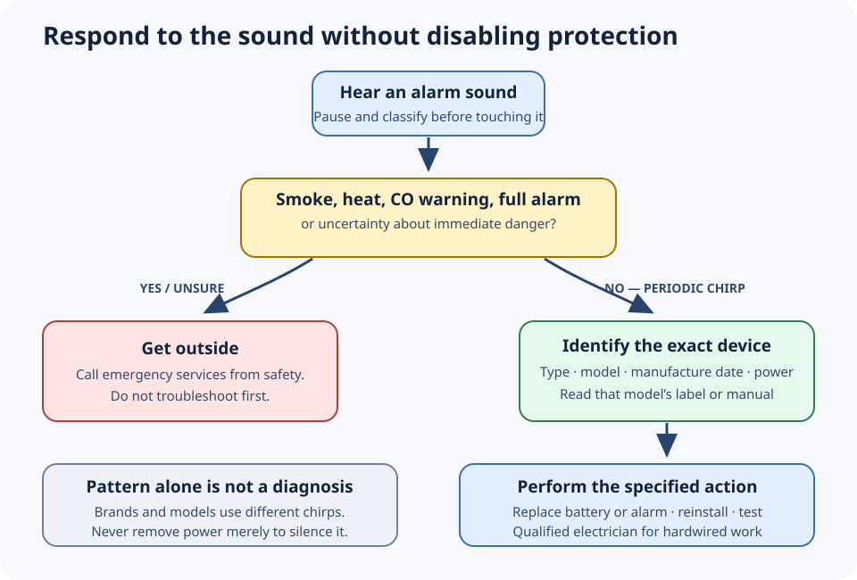

# What does that smoke-alarm chirp mean?

[Front page](../../README.md) · [Resource index](../../archive.md)

**Everyday life / Dad's Field Notes · Safety · Edition 2026-11-16 · Foundation with current fire-safety guidance**

Visual brief: 4 minutes · Optional practice: 15 minutes

> **The takeaway:** A periodic chirp is a maintenance warning, not a universal code. First rule out an active fire or carbon-monoxide alarm, then identify the exact device, model, manufacture date and power type. Follow that model’s manual to replace a battery or the alarm, reinstall it and test it—never leave protection disabled.

## Put danger before diagnosis

An alarm chirps once a minute. Its sealed-battery label says “May 2016.” In November 2026, replace a battery or the whole alarm?

[Open the full-size decision tree](assets/chirp-response.svg). **Text equivalent:** Possible danger or uncertainty leads outside. Only a clearly periodic maintenance chirp proceeds to device identification, its manual, model-specific action, reinstallation and testing.

## Follow one example

The invented alarm is 10 years and 6 months old. The U.S. Fire Administration says replace smoke alarms 10 years from manufacture. Because this unit is sealed, replace the whole alarm according to its instructions. A manual may require earlier replacement.

## Keep this response card

1. **Danger first:** treat smoke, heat, a spoken CO warning, a full alarm or uncertainty as an emergency.
2. **Identify:** find the exact device, model, manufacture date and power type without unsafe climbing or disconnecting hardwired wiring.
3. **Restore:** follow its manual, reinstall it and use its test procedure. Never remove a battery just to silence protection.

Success means the correct alarm remains installed and passes its manufacturer-specified test.

**Limit:** Chirp counts and light patterns vary by brand and model. Smoke, CO and combination alarms are not interchangeable. A generic chart cannot diagnose an unidentified device; hardwired work belongs to a qualified electrician.

## Try and check

**Quick check:** An unidentified alarm chirps once per minute and you see no smoke. Is that pattern alone enough to prove “low battery”?

Reveal the answer

No. Low battery is common, but manufacturers also use chirps for end-of-life, malfunction and other states. Locate the exact device and read its label or manual. If it changes to an alarm, announces CO, or danger is uncertain, leave first.

## Keep exploring

Use the [U.S. Fire Administration’s smoke-alarm guide](https://www.usfa.fema.gov/prevention/home-fires/prepare-for-fire/smoke-alarms/) to check placement, power types, monthly testing and replacement age.

[Full illustrated guide and inspection card](index.html) · [Evidence and limitations](sources.md)
