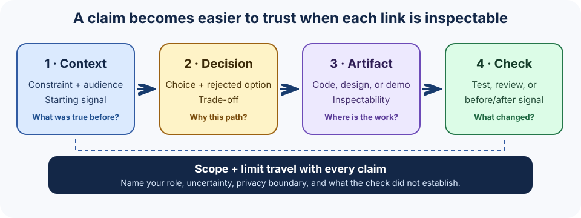

# What makes a portfolio case study believable?

[Front page](../../README.md) · [Resource index](../../archive.md)

**Work & money / Career & Independence · Portfolios · Edition 2026-11-18 · Foundation and editorial synthesis**

Visual brief: 4 minutes · Optional practice: 20 minutes

> **The takeaway:** A believable case study connects a specific situation to your decision, an inspectable artifact, and a check of what changed. Name your own role and one limitation. This chain makes a modest claim easy to examine; it does not prove that you alone caused every result or can repeat it anywhere.

## See the evidence chain

[Open the full-size evidence-chain diagram](assets/evidence-chain.svg). This editorial framework extends situation–task–action–result with an inspectable artifact and an explicit limit. It is not a hiring standard. Each result claim should point to something a reader can examine.

## Follow one invented example

A student writes, “Improved checkout UX.” That is difficult to test. A stronger card says:

- **Context:** In a fictional check, 8 of 20 sample submissions lost required-field feedback.
- **Decision:** Preserve entered values and move the error beside the field.
- **Artifact:** Link the pull request, a before/after recording, and the test script.
- **Check:** In the same invented check, 18 of 20 submissions avoided that error.
- **Limit:** The small sample did not measure long-term conversion or every assistive technology.

The numbers are invented to teach the structure; they are not evidence about a real product.

## Keep this evidence card

Copy five lines into a project README:

1. **Context:** audience, constraint, and starting signal.
2. **Decision:** choice, rejected option, and trade-off.
3. **Artifact:** the smallest inspectable proof.
4. **Check:** test, review, or before/after signal.
5. **Limit:** role, uncertainty, privacy boundary, or next test.

Success means every result claim has an artifact or is labeled as an estimate. Remove secrets and personal data; get permission before showing client or employer work.

**Limit:** A case study is selected evidence, not an independent assessment of skill or sole causation.

## Try and check

Choose one project and draft the five lines in 20 minutes. Start with the smallest claim you can support. If an artifact is private, describe the kind of evidence and what you can safely share instead of inventing proof.

**Quick check:** Which sentence is most believable?

Answer

“I chose inline validation after comparing two options; this test and pull request show the change, while the small sample limits the conclusion.” It connects a decision to inspectable evidence and keeps the boundary visible.

## Keep exploring

[GitHub’s job-search profile guide](https://docs.github.com/en/account-and-profile/tutorials/using-your-github-profile-to-enhance-your-resume) shows how to make selected repositories easier to understand, run, and test. Its text instructions are the primary resource; screenshots are optional.

[Full illustrated guide](index.html) · [Evidence and limitations](sources.md)
