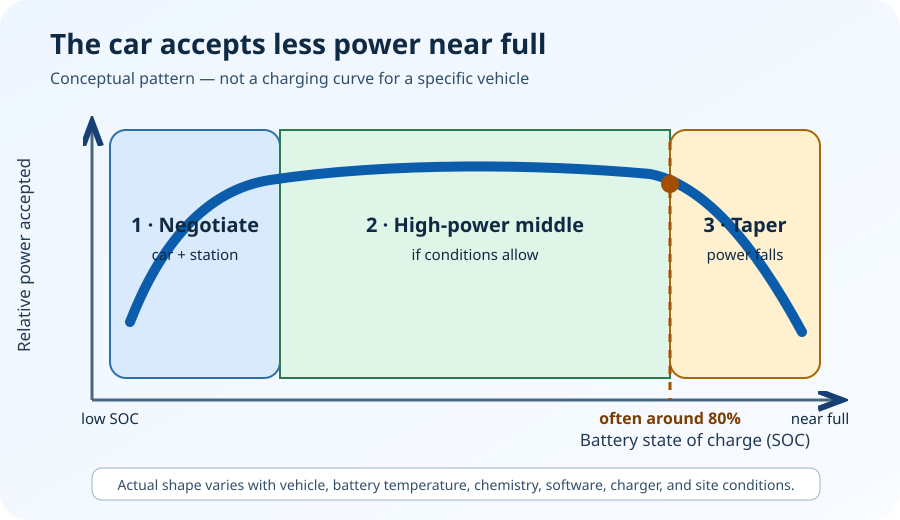

# Why does EV fast charging slow near full?

[Front page](../../README.md) · [Resource index](../../archive.md)

**Frontier technology / The Horizon · Energy storage · Edition 2026-11-19 · Foundation with current public guidance**

Visual brief: 4 minutes · Optional practice: 15 minutes

> **The takeaway:** A fast charger advertises its possible power, but the vehicle decides what its battery can accept. As state of charge rises—often around 80%—that accepted power usually tapers. Read the live kilowatts and your remaining range need together; 80% is a common pattern, not a universal stop rule.

## See the mechanism

[Open the full-size diagram](assets/charge-taper.svg). **State of charge (SOC)** is the battery’s current energy as a percentage of usable capacity. The station offers power; the car accepts a safe amount. NREL’s modeled curves vary by vehicle and generally drop around 80–85% SOC. This is a pattern, not a car specification.

## Follow one example

Imagine a 60 kWh usable battery. Moving from 20% to 80% adds 36 kWh; 80% to 100% adds only 12 kWh. If the first segment averaged 120 kW and the top-up 40 kW, each would take 18 idealized minutes before losses. The numbers are invented; the relationship is the lesson.

## Keep this artifact

Write a four-line road-trip session card:

1. **Start:** current SOC.
2. **Need:** enough energy for the next leg plus your chosen margin.
3. **Watch:** live kW as SOC rises.
4. **Decide:** continue only while the added range is worth the slower minutes.

Choose from route need and the observed curve, not a universal percentage.

**Limit:** Temperature, battery condition, software, charger sharing, and vehicle limits reshape the taper. Follow vehicle and station instructions; this guide cannot predict a trip’s charging time.

## Try and check

Your car is connected to a 150 kW charger. Near 85% SOC, the display falls from 120 kW to 40 kW. Which number now limits charging: the charger’s 150 kW label or the 40 kW the car is accepting?

**Quick check:** Why can the last 20 percentage points take as long as a much larger middle segment?

Answer

The car is accepting 40 kW, so that is the present rate. The last segment can take as long because time depends on energy divided by average accepted power; tapering lowers that average even though fewer kilowatt-hours remain.

## Keep exploring

Read [NREL’s Figure 5 and its explanation](https://docs.nrel.gov/docs/fy23osti/87100.pdf) to compare several modeled charging curves and see why a charger’s peak rating is not a session-wide promise.

[Full illustrated guide](index.html) · [Evidence and limitations](sources.md)
