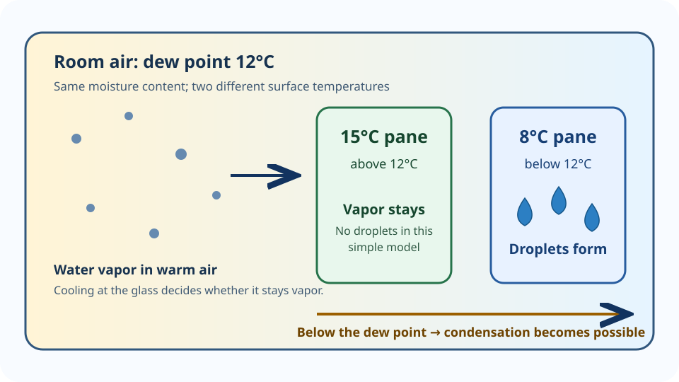

# Why does the inside of a window fog up?

[Front page](../../README.md) · [Resource index](../../archive.md)

**Everyday life / Dad's Field Notes · Home · Edition 2026-11-20 · Foundation with current moisture guidance**

Visual brief: 4 minutes · Optional practice: 20 minutes

> **The takeaway:** Indoor window fog appears when the room-side glass is colder than the air's dew point, so water vapor becomes liquid on the pane. The wet glass is a clue, not a diagnosis: dry it, note where and when it returns, reduce obvious moisture sources, and investigate persistent dampness rather than hiding it.

## See the threshold

[Open the full-size dew-point diagram](assets/window-dew-point.svg). This is a conceptual threshold, not a measured window. **Dew point** is the temperature at which air becomes saturated. Above it, water stays vapor; below it, some vapor condenses. See the National Weather Service's [dew-point guide](https://www.weather.gov/arx/why_dewpoint_vs_humidity).

## Follow one example

Imagine indoor air with a **12°C** dew point. A **15°C** pane is above the threshold, so this model predicts no condensation. An **8°C** edge is below it, so droplets can form. These invented readings isolate the mechanism; they do not predict every window.

## Keep this observation card

1. **Locate:** Is the moisture on the room side, outdoors, or apparently between panes?
2. **Record:** Note time, weather, room activity, and humidity if available.
3. **Dry:** Wipe the wet surface and sill; do not cover recurring dampness with paint or caulk.
4. **Reduce a source:** Use outdoor-vented bath or kitchen exhaust where appropriate.
5. **Recheck:** If water returns, spreads, smells musty, or suggests a leak, report it or ask a qualified professional.

**Limit:** Condensation alone cannot tell you whether the cause is indoor humidity, a cold or poorly insulated surface, restricted airflow, a leak, or several factors together. Opening a window is not suitable when outdoor air is humid, polluted, or unsafe.

## Try and check

For 20 minutes, make a tiny map of one window. Mark the side and the wettest area, then write one reversible action and what would count as improvement on the next similar day. Do not dismantle the window or disturb visible mold.

**Quick check:** Room air has a 12°C dew point. Which surface is more likely to collect water: a 15°C pane or an 8°C pane?

Answer

The 8°C pane. It is below the air's 12°C dew point, so the model predicts condensation there. The 15°C pane is above the threshold.

## Keep exploring

Use the EPA's [mold house window example](https://www.epa.gov/mold/interactive-mold-house-tour) and [moisture-control guide](https://www.epa.gov/mold/brief-guide-mold-moisture-and-your-home) for household actions and professional-help boundaries.

[Full illustrated guide](index.html) · [Evidence and limitations](sources.md)
