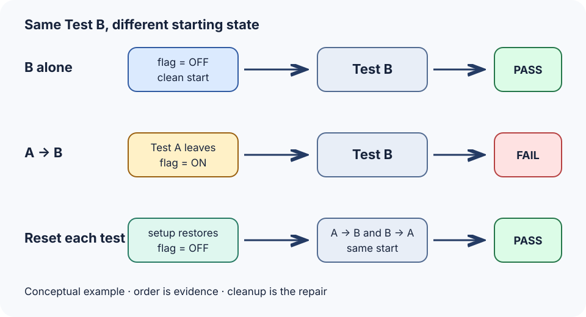

# Why can a test pass alone but fail in the full suite?

[Front page](../../README.md) · [Resource index](../../archive.md)

**Engineering / The Builder's Workbench · Testing · Edition 2026-11-21 · Foundation with current testing guidance**

Visual brief: 4 minutes · Optional practice: 20 minutes

> **The takeaway:** A test that passes alone but fails after another test is often reading state that the earlier test changed and did not restore. Treat order as evidence: identify the smallest failing sequence, list every shared boundary, reset or replace that state per test, then prove both orders pass without retries.

## Follow the state, not the test name

[Open the full-size test-order diagram](assets/test-order.svg). **Text equivalent:** Test B passes alone because the shared flag starts off. In the suite, Test A turns the flag on and does not restore it; Test B then fails. A per-test reset gives both tests the same starting state, so A then B and B then A both pass.

## Read one invented failure

Suppose `test_discount_banner` expects a banner to be hidden by default. Run alone, it passes. Run after `test_enable_beta`, it fails because that test changed a process-wide feature flag. Reversing the two-test order passes. The smallest failing sequence is evidence of an order dependency, not proof that the assertion or runner is random.

## Keep this isolation card

1. **Shrink:** reproduce the smallest sequence and its reverse.
2. **Inventory:** check globals, environment variables, clocks, random seeds, files, databases, caches, ports and background work.
3. **Own:** make setup create the state the test needs; do not borrow it from a previous test.
4. **Restore:** use framework cleanup even when the test fails.
5. **Prove:** run each test alone, both orders, and the full suite without automatic retries.

**Limit:** Order dependence is one cause of suite-only failure. Timing, concurrency, resource pressure, external services and overly strict assertions can produce similar symptoms. Reordering or retrying tests can expose a problem, but it is not the repair.

## Try and check

Use the [20-minute isolation worksheet](worksheet.md) on one suite-only failure. Record the first test that changes state, the later observer, the cleanup owner and the passing verification matrix.

**Quick check:** B passes alone; A then B fails; B then A passes. What is the strongest first hypothesis?

Reveal the answer

A probably leaves state that B observes. Inspect and control that boundary, then rerun both orders. Do not merely pin B before A.

## Keep exploring

Pytest's [flaky-test guide](https://docs.pytest.org/en/stable/explanation/flaky.html) maps order failures to uncontrolled system state, while its [fixture guide](https://docs.pytest.org/en/stable/how-to/fixtures.html#teardown-cleanup-aka-fixture-finalization) shows cleanup patterns.

[Full illustrated guide](index.html) · [Evidence and limitations](sources.md)
