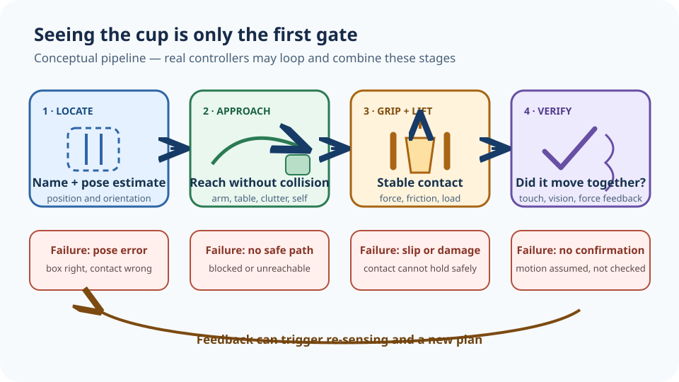

# Why can a robot see a cup but still miss the pick?

[Front page](../../README.md) · [Resource index](../../archive.md)

**Frontier technology / The Horizon · Robotics · Edition 2026-11-22 · Foundation with current NIST benchmarking context**

Visual brief: 4 minutes · Optional practice: 20 minutes

> **The takeaway:** Recognizing a cup answers “what and roughly where?” Picking it also requires a usable pose, a collision-free approach, stable contact, enough friction and force, and feedback after the fingers close. A detection box is therefore one input, not proof of a successful grasp—especially with clutter, transparent objects, or uncertain physical properties.

## See the missing steps

[Open the full-size grasp pipeline](assets/grasp-pipeline.svg). This is a conceptual system diagram, not a measured robot. **Pose** means an object's position and orientation. A camera may identify “cup” while still estimating its pose too poorly for fingers to meet the intended contact points. NIST treats pose estimation, touch sensitivity, force tracking, grasp strength, and slip resistance as separate capabilities.

## Follow one invented pick

A camera outlines a cup on a clear table. The estimate puts its rim slightly left of its real position. The planner chooses two side contacts, but one finger reaches the rim first and nudges the cup. The controller closes harder; the tilted cup still slips during the lift. Recognition was correct. The pick failed later, at contact and verification.

## Keep this pick-readiness card

Before calling a demonstration “reliable,” ask:

1. **Locate:** Is pose uncertainty recorded, not just the object name?
2. **Approach:** Can the arm reach without hitting the table, clutter, or itself?
3. **Contact:** Do the chosen surfaces support the expected load without crushing or slipping?
4. **Verify:** After closing, what signal confirms the object moved with the hand?

Success means the team can name the failing gate and repeat a benchmark—not merely show one good video.

**Limit:** This four-gate model simplifies a coupled control loop. Real systems may re-sense and re-plan continuously, and performance on known rigid objects does not establish capability on transparent, deformable, novel, or cluttered objects.

## Try and check

Use the [20-minute grasp review sheet](review-card.md) on a robotics demo. Record what you can actually observe and mark unknowns instead of guessing.

**Quick check:** A vision system draws the correct box around a cup. Has the robot proved it can pick the cup?

Answer

No. The box does not prove an accurate usable pose, a reachable collision-free approach, stable contacts, adequate grip, or a verified lift.

## Keep exploring

Open NIST's [grasping performance metrics](https://www.nist.gov/el/intelligent-systems-division-73500/robotic-grasping-and-manipulation-assembly/grasping) to compare the separate tests for pose, touch, force and slip. The page is written as a metric catalog, so start with the short descriptions rather than the downloadable test documents.

[Full illustrated guide](index.html) · [Evidence and limitations](sources.md)
