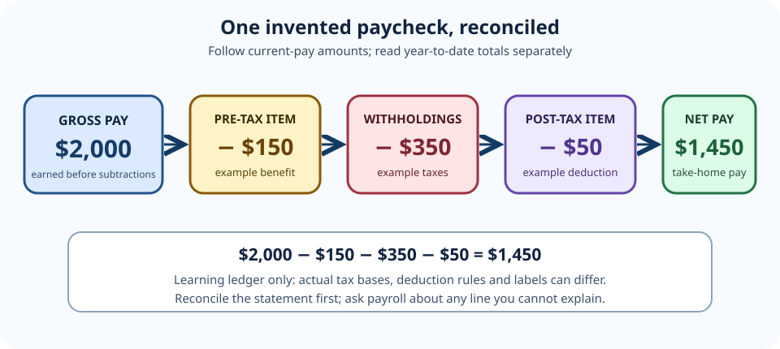

# Where did the rest of my paycheck go?

[Front page](../../README.md) · [Resource index](../../archive.md)

**Work & money / Career & Independence · Pay & benefits · Edition 2026-11-23 · Foundation with current federal guidance**

Visual brief: 4 minutes · Optional practice: 20 minutes

> **The takeaway:** A pay stub reconciles money earned with money received: start with gross pay, account for every current addition, deduction and withholding, then compare the result with net pay. Read current and year-to-date columns separately, and question unfamiliar lines. This is a learning model—real tax bases, benefits and labels vary, so use your statement and official guidance.

## See the money flow

[Open the full-size pay-stub flow](assets/pay-stub-flow.svg). **Gross pay** is what this example earned before deductions. **Net pay**, or take-home pay, is what remains after them. A deduction is any amount subtracted; a withholding is money held back for an obligation such as tax. Labels differ by employer.

## Follow one invented example

This teaching example starts with **$2,000 gross pay**. Subtract a **$150 pre-tax benefit**, **$350 in tax withholdings**, and a **$50 post-tax item**:

`$2,000 − $150 − $350 − $50 = $1,450 net pay`

The arithmetic reconciles the check, but the middle subtotal is not a universal “taxable wages” figure. Social Security, Medicare, federal income tax, state or local tax, and benefits can use different rules. Withholding is also a payment toward a possible tax bill, not the final bill itself.

## Keep this review card

Use the [20-minute pay-stub review card](pay-stub-review-card.md):

1. Match the name, employer, pay period and payment date.
2. Check hours or salary, rate and gross pay.
3. Sort each extra addition or subtraction as reimbursement, tax, benefit or other item.
4. Reconcile gross plus current additions minus current deductions with current net pay.
5. Compare current and year-to-date columns; flag only unexplained differences.

Success means every current-pay subtraction has a label and the arithmetic reconciles. Keep account numbers, tax IDs and the full statement private.

**Limit:** This U.S.-focused lesson explains a reading method, not whether a particular deduction is lawful or whether your withholding is correct. Pay-stub requirements and labels vary. Ask payroll about an unfamiliar line; use official tax guidance or a qualified adviser for your situation.

## Try and check

Without doing tax-rate math, predict the net pay in the invented example above.

**Quick check:** If the current deductions reconcile but the year-to-date total looks surprising, which columns should you compare first?

Answer

Compare each line’s current amount with its year-to-date amount and the number of pay periods so far. Do not subtract a year-to-date amount from one current paycheck. Ask payroll about a jump, a missing period or a label you cannot explain.

## Keep exploring

The [Consumer Financial Protection Bureau’s written paycheck activity](https://www.consumerfinance.gov/consumer-tools/educator-tools/youth-financial-education/teach/activities/understanding-taxes-paycheck/) explains gross income, net income and common tax deductions. Open it to check the vocabulary before reviewing your own statement.

[Full illustrated guide](index.html) · [Evidence and limitations](sources.md)
