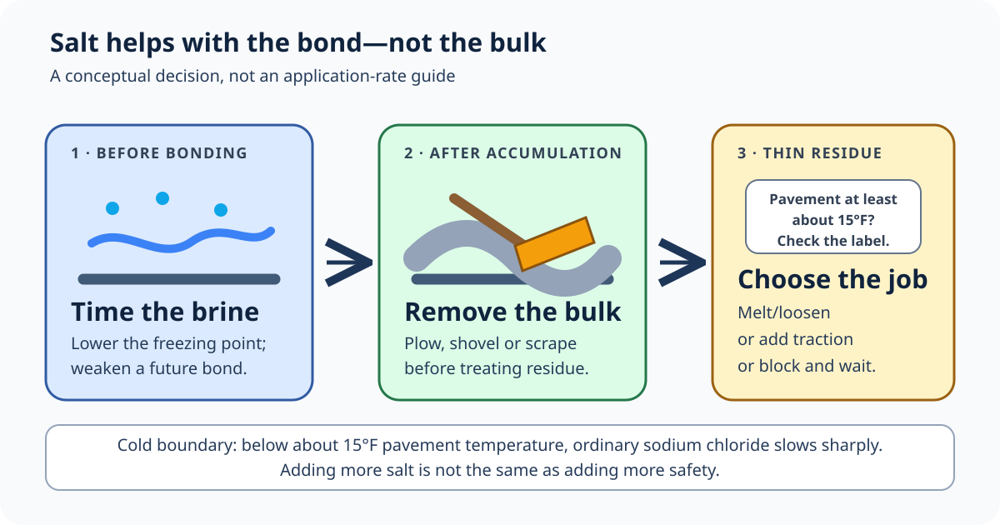

# Why do road crews salt before snow—and why does more salt stop helping?

[Front page](../../README.md) · [Resource index](../../archive.md)

**Everyday life / Dad's Field Notes · Winter surfaces · Edition 2026-11-24 · Foundation with current public guidance**

Visual brief: 4 minutes · Optional practice: 15 minutes

> **The takeaway:** Salt works only after it dissolves into brine. Applied at the right time, that brine lowers water's freezing point and weakens the bond between ice and pavement, making removal easier. But ordinary sodium chloride slows sharply on colder pavement, and excess chloride still reaches water and infrastructure. Remove snow first; treat only what remains.

## See the timing decision

[Open the full-size salt-timing diagram](assets/salt-timing.svg). **Anti-icing** means applying a chemical before a strong ice bond forms. **Deicing** means breaking or melting a bond after it forms. Neither replaces plowing, shoveling or scraping.

## Follow one invented example

A forecast calls for light snow. A road crew sees pavement near 28°F and applies brine before precipitation. The brine does not make the road “ice-proof”; it helps keep frozen material from bonding tightly, so a plow can remove it more readily.

At home, the useful sequence is simpler: clear the walkway early, scrape the thin bonded layer, then use the product label and pavement temperature to decide whether a small amount of deicer is appropriate. If the pavement is near 10°F, adding more ordinary sodium chloride is a poor rescue plan: public guidance puts its lowest practical range around 15°F, and sand supplies temporary traction rather than melting.

## Keep this decision card

Use the [15-minute winter-surface card](winter-surface-card.md):

1. Name the surface and the actual hazard.
2. Remove loose snow or slush first when it is safe to do so.
3. Check pavement temperature, product label and local guidance.
4. Choose melting, traction or waiting—do not assume they are interchangeable.
5. Sweep up leftover material after the event when practical.

Success means the bulk snow is removed, the remaining hazard has a named treatment, and no extra material is being added “just in case.”

**Limit:** A treated surface can still refreeze or stay slippery. Air temperature can differ from pavement temperature. Do not use this lesson to treat public roads, mix chemicals, ignore a product label or promise safe footing. Use local weather and transportation guidance; avoid strenuous clearing if it is unsafe for you.

## Try and check

Predict first: the air is 20°F, but a shaded walkway's pavement is 12°F. Should you choose ordinary salt solely from the air reading?

**Quick check:** What job does sand do that salt does not?

Answer

No. The pavement temperature controls how the deicer meets the frozen surface, and public guidance says ordinary sodium chloride becomes much less practical below about 15°F. Remove what you can safely, follow the product and local guidance, and consider traction. Sand can add temporary grip; it does not melt ice.

## Keep exploring

Open the [Minnesota Stormwater Manual's written winter-maintenance factsheet](https://stormwater.pca.state.mn.us/winter_parking_lot_and_sidewalk_maintenance_factsheet) to compare anti-icing, deicing and traction and to see why pavement temperature—not just air temperature—changes the choice. It is a text-and-table alternative to video.

[Full illustrated guide](index.html) · [Evidence and limitations](sources.md)
