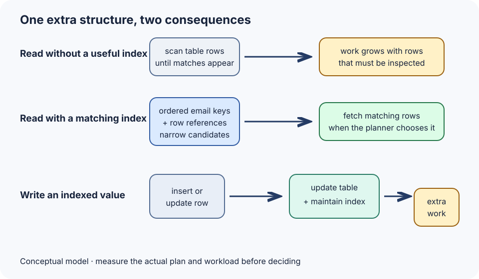

# Why can a database index speed up reads but slow down writes?

[Front page](../../README.md) · [Resource index](../../archive.md)

**Engineering / The Builder's Workbench · Databases · Edition 2026-11-25 · Foundation with current PostgreSQL and SQLite guidance**

Visual brief: 4 minutes · Optional practice: 20 minutes

> **The takeaway:** An index keeps selected values in a searchable structure, so a database can skip much of a table for a matching query. The trade is extra storage and maintenance on every affected write. Add an index for a measured query pattern, then verify the chosen plan and write cost; do not assume every query improves.

## Follow the two paths



[Open the full-size index trade-off diagram](assets/index-tradeoff.svg). **Text equivalent:** Without a useful index, a lookup may inspect the table row by row. An index stores ordered search keys and row references, letting the planner narrow the candidate set before fetching rows. The same extra structure must be updated when indexed values are inserted, deleted or changed.

## Read one invented workload

Imagine one million orders and a support lookup:

```sql
SELECT id, status FROM orders WHERE customer_email = 'reader@example.test';
```

An index beginning with `customer_email` gives the planner a focused route. An overnight report that reads most orders may still favor a sequential scan. Every new order also adds an index entry.

## Keep this index decision card

1. **Name the query:** record its filter, join, ordering and returned columns.
2. **Measure before:** capture the plan and representative latency or work.
3. **Match the key:** put frequently constrained columns first; avoid a redundant prefix index.
4. **Count the cost:** note write rate, storage, build impact and maintenance.
5. **Measure after:** confirm the planner uses the index where expected and that writes remain acceptable.

**Limit:** Selectivity, statistics, cache state, database engine and concurrency can change the best plan. Building an index can disrupt a live system; follow the engine's production procedure.

## Try and check

Use the [20-minute index decision card](index-decision-card.md) for one real or invented query. Predict the plan first, then compare it with evidence from your database.

**Quick check:** A query returns 80% of a table. Must the database use an available index?

<details>
<summary>Reveal the answer</summary>

No. When most rows are needed, walking the table can cost less than following many index references. The planner chooses from its cost estimates and statistics; verify the actual plan.

</details>

## Keep exploring

PostgreSQL's [index introduction](https://www.postgresql.org/docs/18/indexes-intro.html) explains lookup and maintenance costs. SQLite's [query-planning guide](https://www.sqlite.org/queryplanner.html) illustrates single-column, multi-column and covering indexes with concrete searches.

[Full illustrated guide](index.html) · [Evidence and limitations](sources.md)
