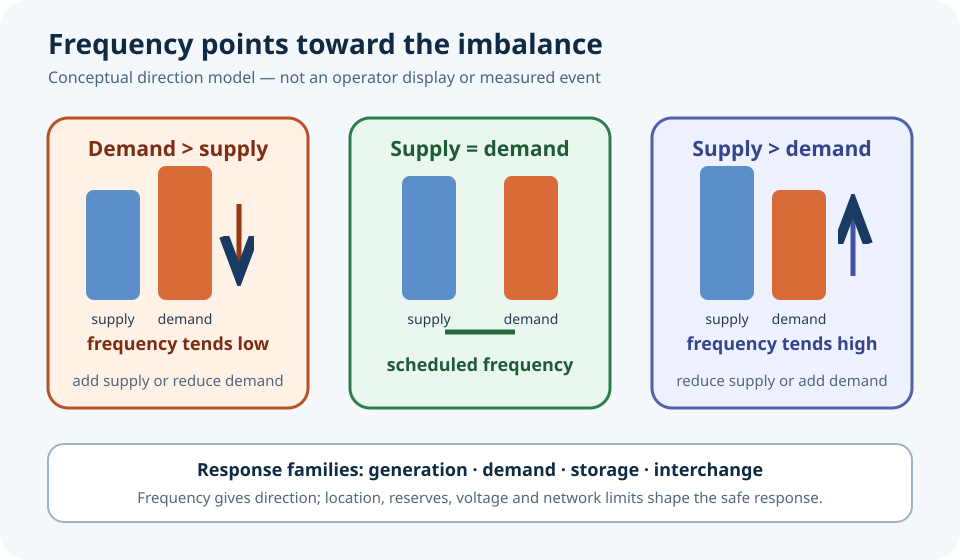

# Why must the power grid keep supply and demand in balance?

[Front page](../../README.md) · [Resource index](../../archive.md)

**Frontier technology / The Horizon · Electric-grid infrastructure · Edition 2026-11-26 · Foundation with current EIA, DOE and NERC guidance**

Visual brief: 4 minutes · Optional practice: 20 minutes

> **The takeaway:** An AC grid is a live balancing system, not a warehouse. When demand exceeds available supply, frequency tends below its scheduled value; excess supply pushes it above. Automatic responses act first, then controls and operators rebalance generation, demand, storage and interchange. Frequency shows direction, not the cause or the remedy by itself.

## See the mechanism

[Open the full-size diagram](assets/grid-balance.svg). **Frequency** is how often alternating current completes a cycle each second. In the continental United States, the scheduled value is normally 60 hertz. A lower value indicates demand is greater than available supply; a higher value indicates the reverse. Real systems continuously make small corrections around that target.

## Follow one example

Imagine an area using 1,000 megawatts while generation plus imports suddenly provide 950 MW. The invented 50 MW shortfall does not tell us the exact frequency change. It does tell us the direction: frequency tends downward. Fast physical and automatic controls respond first. Slower actions can raise generation, discharge storage, increase imports, or reduce demand.

## Keep this artifact

Use the [grid-balance observation card](grid-balance-card.md):

1. Compare supply with demand.
2. Predict whether frequency tends low, on target, or high.
3. Name at least two response families.
4. Check constraints before choosing a remedy.

Success means explaining the direction without claiming that one number diagnoses the event.

**Limit:** This is a directional model, not an operating instruction. Voltage, transmission limits, reserves, location and equipment behavior also matter. Frequency alone cannot identify which generator, line, load or control caused a disturbance.

## Try and check

A windy night brings supply above demand. Before opening the answer, choose a likely direction for frequency and one reversible response.

**Quick check:** Why is “turn on one more generator” not the universal fix for a low-frequency event?

Answer

Frequency tends high when supply exceeds demand; operators could reduce generation, charge storage, increase exports or enable demand. A low-frequency event may instead require generation, storage, imports or demand reduction, but the safe choice depends on location, ramp rates, transmission and reserve limits. Frequency gives the imbalance direction, not a complete diagnosis.

## Keep exploring

Open the [EIA’s electric-system introduction](https://www.eia.gov/electricity/930-content/about.html) and find the paragraph that maps high and low frequency to supply and demand. It is a written beginner resource with an observed disturbance example; no video is required.

[Full illustrated guide](index.html) · [Evidence and limitations](sources.md)
