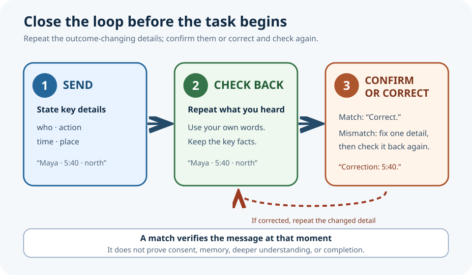

# Why repeat an instruction back in your own words?

[Front page](../../README.md) · [Resource index](../../archive.md)

**Everyday life / Dad's Field Notes · Communication · Edition 2026-11-27 · Foundation with current AHRQ and FAA guidance**

Visual brief: 4 minutes · Optional practice: 15 minutes

> **The takeaway:** A check-back closes the communication loop: the sender states the important details, the receiver repeats what they heard, and the sender confirms or corrects it. That small loop can expose mismatched names, times, places, and actions before work begins. It verifies the message—not consent, memory, or emotional agreement.

## See the mechanism

[Open the full-size diagram](assets/check-back-loop.svg). A check-back is more than “okay.” It gives the sender something concrete to inspect. If the repeat is wrong, correct the smallest wrong detail and run that part of the loop again.

## Follow one example

Sender: “Pick up Maya at **5:40** at the **north entrance**.”

Receiver: “Maya, 5:40, north entrance.”

Sender: “Correct.”

Suppose the receiver instead says “5:14.” The sender can answer, “Correction: 5:40,” and ask for that detail again. The loop ends only when both versions match. This invented example isolates the mechanism; it does not show that the receiver will remember or carry out the task.

## Keep this artifact

Use the [check-back card](check-back-card.md):

1. Circle the details that would change the outcome: person, action, time, place, amount, or sequence.
2. Ask the receiver to repeat those details in their own words.
3. Confirm them, or correct one mismatch and check again.
4. Move private details to an appropriate channel.

Success means both people can state the same actionable details without looking at each other's notes.

**Limit:** A matching repeat verifies what was heard at that moment. It does not prove comprehension, consent, memory, or completion. Do not echo passwords, account numbers, medical details, or other sensitive information where others can hear or see them. In an emotional conversation, listening and curiosity matter more than turning every sentence into a script.

## Try and check

Before revealing the answer, choose the better response to “Meet Jordan at the west desk at 3:15”: **A)** “Got it,” or **B)** “Jordan, west desk, 3:15.”

**Quick check:** If the receiver repeats “east desk,” what should the sender do next?

Answer

Choose B because it exposes the receiver's version of the key details. If they say “east desk,” correct the location—“west desk”—and ask them to check back that detail again. A silent assumption or a generic acknowledgment does not close the loop.

## Keep exploring

Open [AHRQ's Check-Back tool](https://www.ahrq.gov/teamstepps-program/curriculum/communication/tools/checkback.html) for a short written explanation and examples. It is the direct beginner resource behind this lesson; no video is required.

[Full illustrated guide](index.html) · [Evidence and limitations](sources.md)
