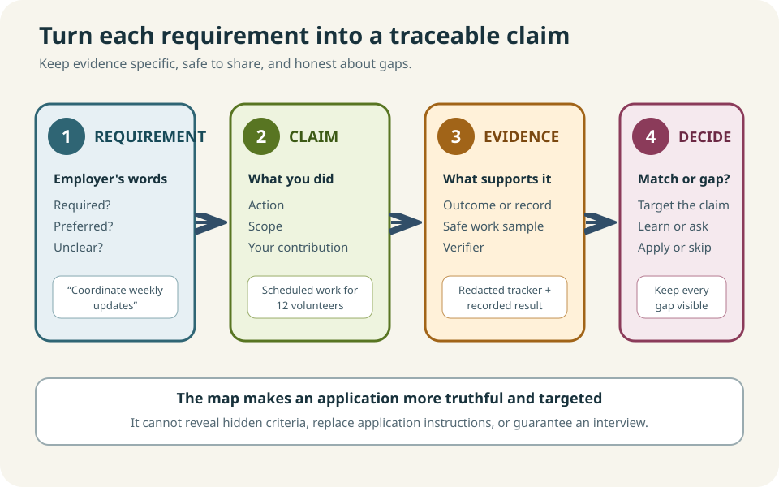

# How do you turn a job posting into an evidence map?

[Front page](../../README.md) · [Resource index](../../archive.md)

**Work & money / Career & Independence · Careers · Edition 2026-11-28 · Foundation with current U.S. Department of Labor resources**

Visual brief: 4 minutes · Optional practice: 20 minutes

> **The takeaway:** Treat each important line in a job posting as a claim that needs evidence. Separate required from preferred criteria, match each requirement to a specific example and observable result, then mark honest gaps. The map helps you target an application; it cannot reveal hidden hiring criteria or guarantee an interview.

## See the mechanism

[Open the full-size diagram](assets/job-evidence-map.svg). For each line, ask: **What would I claim? What could someone inspect? What is still missing?** Evidence can be an outcome, work sample, record, or verifier—not a made-up metric.

## Follow one example

An invented posting says: “Coordinate weekly updates and track deadlines.” A candidate ran an eight-week volunteer schedule.

- **Claim:** Coordinated weekly assignments for 12 volunteers.
- **Evidence:** A redacted tracker, schedule dates, and a coordinator who can confirm the role.
- **Result:** Missed handoffs fell from four in the first two weeks to one in the last two weeks. These numbers are fictional; a real applicant must use records they can defend.
- **Gap:** The posting also requires a named scheduling tool the candidate has not used. Mark that gap instead of implying experience.

## Keep this artifact

Use the [20-minute job-evidence map](job-evidence-map.md):

1. Copy three high-priority requirements exactly.
2. Label each **required**, **preferred**, or **unclear**.
3. Add one specific example and one inspectable signal.
4. Mark a gap and choose: learn, ask, apply honestly, or skip.

Success means each draft claim traces to a real example and every unmet requirement stays visible.

**Limit:** A posting may be incomplete or interpreted differently by a recruiter. Never expose confidential files, customer data, private feedback, or another person's identity as proof. Redact or describe sensitive work and follow the application instructions.

## Try and check

Before revealing the answer, choose the stronger support for “trained new teammates”: **A)** “Good communicator,” or **B)** “Built a three-step onboarding checklist, used it with four volunteers, and kept the redacted checklist.”

**Quick check:** What should you write when a required credential is missing?

Answer

Choose B because it names an action, scope, and inspectable artifact. If a required credential is missing, mark the gap plainly. Do not relabel it as preferred or imply you hold it; verify whether the requirement is truly mandatory before deciding whether to apply.

## Keep exploring

Open CareerOneStop's written guide to [analyzing job postings](https://www.careeronestop.org/Veterans/JobSearch/ResumesAndApplications/analyzing-job-postings.aspx). Look for the distinction between required and preferred criteria and the advice to identify qualifications, skills, and experience before tailoring an application.

[Full illustrated guide](index.html) · [Evidence and limitations](sources.md)
