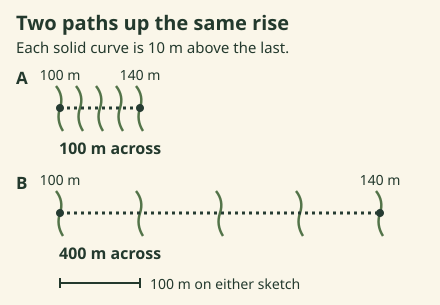

# A hill, a heat pump and a book fair

**Learnings via Graphics · Sunday, November 15, 2026**

Two paths climb from 100 to 140 metres. A heat pump delivers three units of heat while its electricity meter records one unit used. Four buyers hand you enough cash to rent a table, yet you’re still short. Pick whichever puzzle catches your eye. Each answer opens right here on GitHub.

## Everyday life · Read the hill

Path A gains 40 metres in 100 metres across the map. Path B gains the same height in 400 metres. **Which climb is gentler on average?**

Check the paths

B spreads the climb over four times the horizontal distance. Its average grade is 10%, compared with 40% for A. The contour curves on B are farther apart. A trail’s surface could still change how it feels.

[Read the map brief](../editions/2026-11-15-reading-contours/brief.md) · [Watch Ordnance Survey trace the contours on YouTube](https://www.youtube.com/watch?v=4i_6eToM3X8) · [Follow their illustrated explanation](https://osmaps.com/discover/guides/understanding-map-contour-lines-for-beginners/)

## Frontier technology · Account for the heat

During one imaginary hour, a home heat pump uses 1 kilowatt-hour of electricity and delivers 3 kilowatt-hours of heat. **Where did the other 2 come from?**

Trace the two inputs

The outdoor coil takes heat from the air. In our simplified hour, those 2 units join the 1 unit of electricity to supply 3 indoors. You would need many more measurements to estimate what happens across a winter.

[Read the heat-pump brief](../editions/2026-11-15-heat-pump/brief.md) · [See how a refrigerator helps explain the cycle](https://www.energy.gov/articles/pump-your-savings-heat-pumps)

## Work & money · Count the booklets

A market table costs $24. You sell four handmade booklets for $6 each. You spend $2 on paper and ink for each one. **Does the $24 in your till cover the day?**

Count what each buyer contributed

The four sales used $8 in materials, leaving $16 toward the $24 table fee. You’re $8 short. Two more sales add $4 each. Six sales cover the costs in this example.

[Read the book-fair brief](../editions/2026-11-15-zine-table/brief.md) · [Try the SBA’s break-even calculator](https://bec.www.sba.gov/)

**From the Engineering shelf.** What happens if a computer loses power halfway through a save? Trace the two possible versions of a file in [Safe Saves](../editions/2026-10-13-safe-saves/brief.md).

[Browse all four sections](../archive.md) · [Open the hands-on guides offline](../docs/reading-guide.md)
